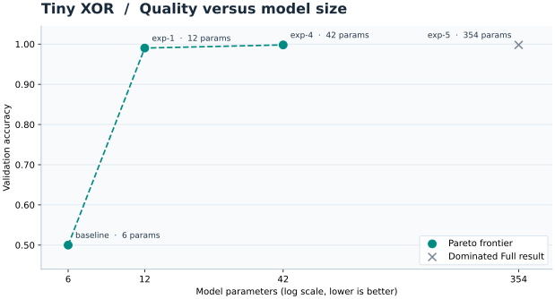

# WP-06.3 · Pareto 多目标科研优化

AXIOM 用独立 Full 评价构建非支配集合，再按任务审批的偏好交付。Pi 提供原生会话、工具调用和模型用量，AXIOM 负责目标校验、排序、预算、证据、恢复和产物交付。Pi Durable 继续保存权威的实验记录。

## 目标与比较规则

v4 TaskSpec 审批目标、交付偏好和 Full 名额。Tiny CPU 支持以下固定定义，参数量由单独的可信入口 `pareto_validate.py` 在验证 checkpoint 与候选哈希后重新构造模型计算。训练记录的参数量必须与独立计算一致。模型工具无法写入指标。

| 指标 | 方向 | 合法范围 | 比较分辨率 |
| --- | --- | --- | --- |
| validation accuracy | 最大化 | 有限数 [0, 1] | 最近的 1e-12 分桶 |
| parameters | 最小化 | 整数 [1, 1024] | 精确 |
| validation loss（可选） | 最小化 | 有限数 [0, 1e6] | 最近的 1e-9 分桶 |

在每个方向上都不差且至少一个目标严格更优，才构成支配。缺失指标、非有限值、越界值、非法参数量和低保真结果拒绝入集。小候选池使用确定性的两两比较。相同分桶向量由字典序最小的指纹选代表，ID 用于指纹也相同时的排序。每条有效 Full 结果仍在账本中。全量合并后的正式非支配关系与输入顺序无关，过程变化历史保留实际提交顺序。计算耗时、训练步数与 Token 单独计入搜索预算。

## 交付偏好

| `delivery_preference.strategy` | 选择规则 |
| --- | --- |
| `quality` | 按 accuracy、参数量、可选 loss 顺序选择 |
| `lightweight` | 先最小参数量，再按 accuracy 和可选 loss 选择 |
| `minimum_accuracy` | 用原始 accuracy 比较用户阈值，再从达标前沿选最小模型。无达标模型时记录原因并不交付 |
| `frontier` | 交付所有非支配代表，质量优先项作为主项 |

交付目录为 `pareto-delivery/`。清单含用户偏好、正式评分、选择原因和每个成员的独立核验哈希。整个目录先暂存并逐成员核验，后通过同卷改名发布。恢复时根据原 Full 结果重算前沿、变更历史与偏好决定，并核对已交付成员。任务审批、预算、阶段和操作意图继续沿用原账本机制。

## 分级协同与反馈

v4 审批 `full_only`。Tiny CPU 尚无多目标代理校准，Accuracy Proxy 即使能识别部分低质量候选，也不能估计小模型是否仍有非支配价值。该模式由 L0 直接启动 L3，避免用单一分数剪枝，也避免无用的 Smoke/Proxy 支出。Full 名额用尽后立即关闭候选准入。v1–v3 保持原语义，v3 单目标策略仍可选择多保真剪枝。

候选工具返回当前前沿、历史变动、独立目标值、失败、阶段证据和剩余预算。v4 的提案同时提供假设、解释和 `evidence_refs`。引用只能指向已存在的实验 ID。提案中的文字用于解释，评分和晋级仍由宿主执行。

在 Pi 中输入以下命令并确认即可运行。

```text
/axiom-task {"version":4,"task":"tiny-xor-v1","goal":"Choose the smallest model with validation accuracy at least 0.95","objectives":["accuracy","parameters"],"delivery_preference":{"strategy":"minimum_accuracy","minimum_accuracy":0.95},"rules":{"pretrained_weights":false,"extra_data":false,"network":false,"editable":"model.py","evaluation":"validation"},"parameters":{"learning_rate":{"min":0.005,"max":0.08}},"max_revisions":1,"fidelity":{"strategy":"full_only","max_full":3},"budget":{"max_experiments":4,"wall_seconds":800,"max_tokens":220000,"compute_process_seconds":650,"training_steps":400,"cpu_threads":1,"device":"cpu"}}
```

## 验收命令

```powershell
npm run build:offline
npm run check
node --test tests/axiom/pareto.test.mjs
npm run test:ml
```

Windows 离线构建和静态检查通过。Pareto 定向测试 **4/4**，全量 ML **98/98**，包括 Python 18、Node 63、Pi Session 17 项，无跳过，保留原有 94 项回归。

| Case ID | 验收点 |
| --- | --- |
| PF-063-01 | 混合方向、支配淘汰、分桶等价、输入重排和可选第三目标 |
| PF-063-02 | 拒绝 Proxy、缺失目标、非法范围和非整数参数量 |
| PF-063-03 | 四类交付偏好、无可行解和 v4 审批边界 |
| PF-063-04 | 真实 CPU、前沿与预算跨进程重建、非法引用拒绝、防重、Full 配额、完整前沿交付和成员篡改拒绝 |

## 固定候选池 CPU 对照

Windows 定向任务 `private/wp04-5xUxyj/` 固定训练种子 42、数据与 80 步训练配置。单目标和多目标规则读取同一批独立 Full 评估，避免把重新训练的差异算作选择收益。实验全程模型调用为零。首次 Full 完成后强制退出，恢复检查点的前沿和 160 步预留保持一致。非法证据 ID 未启动进程，重复提案只复用前一结果。实际训练启动为 baseline、`exp-1`、`exp-4`、`exp-5`，共 320 步。达到三个候选 Full 名额后，即使还有提案名额也停止。

| 独立 Full 结果 | 参数量 | Accuracy | Loss | Pareto 状态 |
| --- | ---: | ---: | ---: | --- |
| baseline，线性 | 6 | 0.500000000 | 0.692906082 | 非支配 |
| `exp-1`，宽度 2 Tanh | 12 | 0.990234375 | 0.035528459 | 非支配 |
| `exp-4`，宽度 8 Tanh | 42 | 0.998046875 | 0.006301570 | 非支配 |
| `exp-5`，两层宽度 16 ReLU | 354 | 0.998046875 | 0.005981156 | 被 `exp-4` 支配 |



在准确率单目标下选 `exp-4`。质量优先也选 `exp-4`，轻量优先选 baseline，门槛 0.95 后最小化参数量选 `exp-1`。相对于单目标选项，`exp-1` 减少 71.4% 参数，准确率降低 0.78125 个百分点。实际任务审批的是完整前沿，交付并独立复验三个成员。其他偏好用同一批正式结果重算选项。被支配的大模型 loss 较低，本次审批的目标仅含 accuracy 和参数量，不能从该对照推断启用 loss 时的前沿。改动非主成员权重后恢复被拒绝。

本任务以全训覆盖所有三个不同候选，未执行 Proxy 剪枝，因此不存在代理漏选。结果覆盖的是所提交的固定候选池。

全量重跑任务 `private/wp04-dwvmcP/` 复现相同的准确率、参数量、前沿与偏好选择。

## 真实模型反馈闭环

在 Windows 通过 Pi 原生 RPC 使用隔离配置的 `deepseek/deepseek-flash`。任务审批准确率至少 0.95 时交付最小模型，Full 上限三个。提示要求每次等待上轮反馈再自主提出不同结构，不提供固定候选。基线为 6 参数、accuracy 0.5。权威实验目录为 `private/wp04-a5WSnf/`。

| 自主候选 | 假设与实际引用 | 参数量 | Full accuracy | 前沿变化 |
| --- | --- | ---: | ---: | --- |
| `exp-1` | 根据 baseline 线性模型 0.5，尝试宽度 4 的 Tanh 捕捉 XOR 非线性 | 22 | 0.998046875 | 新增 `exp-1` |
| `exp-2` | 引用 `exp-1` 与 baseline，缩至宽度 2 并试探能否继续超过 0.95 | 12 | 0.990234375 | 新增 `exp-2` |
| `exp-3` | 引用 `exp-2`、`exp-1` 与 baseline，在相同参数量尝试用 ReLU 提升准确率 | 12 | 0.750000000 | 被 `exp-2` 支配 |

最终交付 `exp-2`，达标候选中参数最少。交付 SHA-256 为 `e09addfec462e510a5491ced08859dfbae40015be226d91e58d773b1eeac6d29`。Pi 记录 **5 次请求、24,546 Token、估算 USD 0.004561512**，费用来自 Pi 模型元数据估算。训练使用 320 步。用量记录保存在 `private/wp063-live-SRlWyO/usage.json`，独立复验入口为 `python examples/tiny-ml-eval/pareto_validate.py --run private/wp04-a5WSnf/pareto-delivery/exp-2`。

## 当前限制

端到端实测限于 Windows Tiny CPU、固定训练种子和 validation。正式前沿的规模由已评价候选决定，不代表整个架构搜索空间。Loss 目标覆盖协议和算法测试，真实报告使用准确率与参数量。多目标 Proxy 的校准与是否能加速较重任务另行验收。
